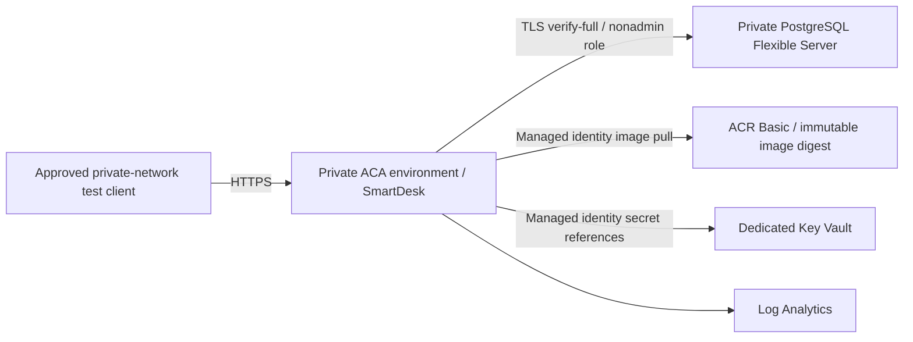

# Session 5 — Azure deployment preparation

## Mandatory zero-Azure-spending policy

**Deployment status: Prepared, not deployed. Authorized Azure spending: EUR 0.**

The user's zero-cost requirement supersedes any earlier proposed deployment budget or approval sequence. This educational project permits infrastructure-as-code, documentation, offline command rendering and local validation only. Do not provision cloud infrastructure, deploy, activate/upgrade paid subscriptions, or consume promotional credits. A free-tier label, scale-to-zero, budget alert or unspent credit does not establish guaranteed zero charges. No company tenant, subscription or credential may be accessed.

The preserved ACA/ACR/PostgreSQL architecture is a paid reference design and is incompatible with the current spending policy. Earlier cost estimates and deployment procedures are educational comparisons, not an approved plan or authorization. If the instructor requires an actual deployment, first establish a genuinely zero-cost option and all eligibility/usage limits from current official evidence, then obtain explicit user approval for that exact option. No such option or deployment is currently verified or approved. No cloud action is authorized by a general review of these documents.

Prefer local PostgreSQL, Docker and Kubernetes demonstrations in a separately approved dedicated personal environment. The current shared Docker environment remains off limits; this policy does not authorize any container or network operation. See [zero-cost training alignment](10_zero_cost_training.md) for the evidence and eight-session status.

## Scope and instructor evidence

This is a local preparation proposal based on Session 4 commit `84a058a8f0d2d40732576523084493c4ee103ca8`. No Azure login, account/subscription discovery, provider registration, cloud validation, resource creation, image publication or deployment was performed. No Docker commands were run: the available Docker environment is shared with protected unrelated/company resources.

The available [instructor repository](https://github.com/smartlearningci/smartdesk) describes FastAPI, PostgreSQL, local Docker and training progression. Full Session 5 notebooks, an Azure service prescription, region, subscription offer, naming, screenshots, assessment thresholds and deployment acceptance are unavailable. **AKS is not confirmed as an instructor requirement.** Earlier k3s work does not establish an AKS requirement. Confirm that point before treating this proposed platform as instructor acceptance.

## Proposed architecture

Use Azure Container Apps (ACA) Consumption, Azure Container Registry (ACR) Basic and Azure Database for PostgreSQL Flexible Server. Propose `westeurope` as a reproducible pricing reference, pending user approval, personal-subscription policy, SKU availability and quota checks. A region price entry does not prove a subscription can deploy that SKU. No tenant or subscription has been inspected.

| Component | Draft configuration and purpose |
| --- | --- |
| ACA | Workload profiles environment with only Consumption; 0.25 vCPU/0.5 GiB; minimum zero, maximum one replica; single revision |
| Network | New personal VNet; separate delegated ACA `/23` and PostgreSQL `/27` subnets; private DNS zones/links |
| App ingress | Internal load-balancer environment, public network access disabled; HTTPS-only app ingress on target port 8000 |
| PostgreSQL | Version 16, B1ms burstable, 32 GiB storage, seven-day local backup retention, no HA or geo-redundant backup in this small lab proposal |
| ACR | Basic, administrator credentials disabled; authenticated registry endpoint; no anonymous publication |
| Identity | One user-assigned identity, `AcrPull` scoped to this registry and `Key Vault Secrets User` scoped to this dedicated vault |
| Secrets | Versioned Key Vault references for a distinct runtime DB password and session signing key; no runtime secret values in templates |
| Logs | Log Analytics PerGB2018, 30-day retention, proposed 0.1 GiB/day ingestion cap; console/system logs only, no payload or credential logging |

The app's `external_enabled=true` ingress property means access through its environment boundary. Because the environment uses an internal IP and disables public access, this is **VNet-only**, not public internet exposure. Setting app ingress to internal would hide it from ordinary VNet clients too. The environment has no public app endpoint. The workload-profiles network nevertheless includes provider-managed load-balancer and egress-public-IP resources in an infrastructure resource group; these incur charges and do not make the app publicly reachable. See the [cost model](09_session_5_costs.md).

Internal environment accessibility cannot be changed into an internet-facing endpoint in place. Future public publication requires an explicitly reviewed replacement/migration or an approved public edge design, updated DNS/certificates, routing, costs and application security. No such resources are included or approved. A private test client and private DNS/network path are also prerequisites; no VPN, VM, Bastion, private endpoint, NAT Gateway, Front Door, Application Gateway or AKS cluster is provisioned by this draft.

ACR Basic and the dedicated Key Vault use authenticated public service endpoints for this minimum proposal. They are not anonymous application endpoints. Private ACR connectivity would require a different registry tier and additional networking/cost review. Secrets remain protected by RBAC; the app identity cannot push images, administer the vault or access a subscription. The template assigns no subscription-wide role, no app Contributor/Owner role, no wildcard custom role and no broad PostgreSQL Azure-services firewall exception.

## Service evaluation

ACA removes cluster/node administration for this single HTTP application and supports scale-to-zero, HTTPS ingress, revisions, identity and secret references. Its cold-start behavior and one-replica capacity are not validated. ACR provides an Azure-native registry with scoped managed-identity pulls; a reviewed public registry could be an alternative, but the user's publication destination is not yet approved. Flexible Server keeps database storage, backups and patching separate from ephemeral application replicas.

AKS adds cluster/node-pool/networking/upgrade work and billable compute that the current application does not require technically. If the instructor requires Kubernetes or AKS-specific tasks, prepare a separate costed proposal after obtaining those instructions. Local k3s is not portable proof of AKS acceptance.

## Application compatibility and security findings

The current image declares UID/GID 10001 and port 8000. ACA requires a Linux x86-64 (`linux/amd64`) image; this Apple Silicon host's previous native builds do not prove that target. Build and validate on a separately approved dedicated personal Docker environment, publish only after authorization, and supply the verified registry `sha256` digest. Floating Python/PostgreSQL base tags and lockfile limitations remain documented Session 4 blockers.

The application supports separate PostgreSQL connection components. The draft supplies `PGSSLMODE=verify-full` and `PGSSLROOTCERT=/etc/ssl/certs/ca-certificates.crt` through libpq's environment, with the exact server FQDN as `POSTGRES_HOST`. Before deployment, verify that the final image contains a readable trust bundle with the currently required Azure root CAs and prove hostname/certificate validation against the new private server. Do not weaken verification to bypass failures. No database connection or certificate validation against Azure was performed.

A separately approved private bootstrap operation must first verify the exact new server/host and database, then transactionally create `smartdesk_app`, grant connection and schema usage/create in only the new `smartdesk` database, and seed its matching secret. The proposed SQL is not executed automatically or in this session. Runtime does not receive the administrative password or server-creation identity. The proposal revokes PUBLIC connection to the new application database; existing PostgreSQL PUBLIC defaults elsewhere must still be reviewed. Explicit grants in this script do not prove that catalog/other-database connections are impossible. Existing startup creates tables, so this initial runtime role still needs DDL privileges in its application schema; separating migrations and runtime DML requires a later reviewed application change. No existing data migration is assumed.

The administrative password uses Terraform's ephemeral sensitive input and the provider's write-only argument/version. Runtime secret values are separately seeded in Key Vault and referenced by version, not materialized as Terraform secret resources. Still protect state/plans/backends and access logs because infrastructure metadata is sensitive. The required `azurerm` backend declaration and placeholder `backend.example.hcl` do not create a backend. An encrypted, access-controlled backend must be separately approved and prepared before any future plan/apply; local validation uses `-backend=false`. Private backend configuration, variable JSON and plan files are ignored, and rendered plan paths point into ignored workspace reports. Do not pass secrets through CLI arguments, source, public logs or committed variable files.

Secure, HTTP-only, SameSite cookies and CSRF remain enabled. Session signing keys must remain stable across revisions; changing them invalidates sessions. Login throttling is process-local and keys on the socket client IP. ACA's proxy topology and Uvicorn trusted-forwarder configuration need review; blindly trusting forwarded headers or adding replicas is not acceptable. A maximum of one replica limits distribution but does not solve proxy identity, restart resets or public abuse. Account bootstrap, password policy, session revocation, edge controls, TLS behavior and client-IP handling require public-readiness review before publication.

Probes use existing `/login` on port 8000. Startup waits up to approximately five minutes; readiness and liveness check HTTP responsiveness. They do not continuously query the database and cannot certify database health after startup. A dedicated dependency-aware readiness endpoint is a proposed application change, not implemented acceptance. PostgreSQL backup retention is a configured intention, not a tested restore. Define required RPO/RTO and run restore into a new server before claiming recovery readiness.

## Template layout and validation boundaries

`infra/azure/versions.tf` pins AzureRM 5.14.0, disables automatic resource-provider registration and CLI/MSI authentication. Local provider schema checks do not authenticate. The future authentication method must be approved and deliberately configured before any cloud command. `foundation.tf` defines the foundation; `application.tf` defaults to no app until `deploy_application=true`, a verified image digest and two existing secret versions are supplied. This separates infrastructure, registry publication, database bootstrap and application launch.

`prevent_destroy` guards the resource group, server, database, registry, vault and app in this configuration. It is a Terraform planning safeguard, not Azure RBAC enforcement or a guarantee against portal deletion. Vault purge protection and soft delete protect recovery but can preserve names after cleanup. No destroy or deletion commands are generated.

Local tooling: Terraform 1.16.1 is installed; Azure CLI and Bicep were not found on PATH. Only public provider downloads, formatting and local schema validation were performed. The initial draft had eleven provider-schema errors; they were corrected to match the pinned provider's DNS ID fields and RBAC attribute. Final local validation returned zero errors and zero warnings. It does not prove service availability, quotas, DNS reachability, identity propagation, certificate trust, valid Azure policy, successful resource creation or deployment.

## Official references

- [ACA networking](https://learn.microsoft.com/en-us/azure/container-apps/networking)
- [ACA ingress boundary behavior](https://learn.microsoft.com/en-us/azure/container-apps/ingress-overview)
- [ACA custom virtual network infrastructure and charges](https://learn.microsoft.com/en-us/azure/container-apps/custom-virtual-networks)
- [ACA Linux x86-64 container support](https://learn.microsoft.com/en-us/azure/container-apps/containers)
- [Managed-identity ACR pulls](https://learn.microsoft.com/en-us/azure/container-apps/managed-identity-image-pull)
- [ACA Key Vault secret references](https://learn.microsoft.com/en-us/azure/container-apps/manage-secrets)
- [ACA probes](https://learn.microsoft.com/en-us/azure/container-apps/health-probes)
- [PostgreSQL TLS and current trusted roots](https://learn.microsoft.com/en-us/azure/postgresql/security/security-tls)
- [AzureRM provider](https://registry.terraform.io/providers/hashicorp/azurerm/5.14.0/docs)
- [Terraform ephemeral variables](https://developer.hashicorp.com/terraform/language/values/variables#ephemeral)
